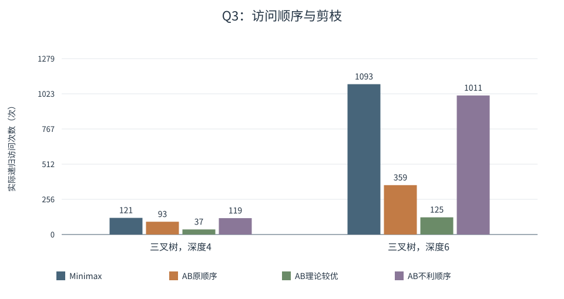

# 当代人工智能实验课

**实验二：搜索算法**

姓名：刘毅　学号：10245501453

GitHub：[https://github.com/Yujuanxiaozhu/contemporary-artificial-intelligence](https://github.com/Yujuanxiaozhu/contemporary-artificial-intelligence)

实验二代码位于仓库 `lab2/` 目录，完整报告与原始实验记录也保存在该目录中。

## 1. 实验目标与算法设计

本实验依次实现单位代价迷宫 A*、加权地形 A*、Minimax 与 Alpha-Beta，并将路径搜索和博弈搜索结合，解决竞争宝藏分配。除核对官方结果外，还比较启发函数、搜索深度、访问顺序和距离缓存的实际作用。

### 1.1 环境与验证方法

程序在 Windows 下运行，核心算法与测试仅依赖 Python 标准库，使用 `heapq`、`dataclasses`、`unittest` 和 `perf_counter()`。题一、二最初在 Python 3.11.9 验证20个测试；四题完整验证和正式性能对照使用 Python 3.12.14。完整自动测试共 **62 tests passed**，覆盖官方样例、同起终点、无解、单一路径、多条最优路径，以及随机树和博弈状态的一致性。

题一每配置10张可达随机地图，题二每尺寸也为10张；题一用独立 BFS、题二用独立 Dijkstra 核对最优费用，题四36项距离另由独立 Dijkstra 验证。随机输入和种子已保存在 `results/report_data/`。题一基础种子为20261015，题二为20261115；完整三叉树深度4、6的种子为20261219、20261221。

### 1.2 核心实现

**A*。** 状态为 `(row,col)`，四方向移动，优先级 `f(n)=g(n)+h(n)`。用最优 g 表和父节点表记录当前路线，只在 g 严格改善时入堆；过期条目出队后跳过，目标有效出队时恢复路径。相同 f 按入堆顺序处理，邻居顺序固定为上、下、左、右。`h=0` 是一致代价搜索对照。题一无解返回 `[]`，题二无解返回 `-1`；题二起点不收费，进入终点 E 的最后一步免费。

**Minimax。** MAX 取子值最大值，MIN 取最小值，叶值逐层回传。题三根为 MAX；题四 A 为 MAX、B 为 MIN。默认使用原始动作顺序，不缓存博弈子树结果。

**Alpha-Beta。** alpha 是 MAX 已能保证的下界，beta 是 MIN 已能保证的上界；MAX 更新 alpha，MIN 更新 beta。当 `alpha >= beta` 且还有未访问子节点时，跳过这些分支。初始窗口为负无穷到正无穷，最终值与完整 Minimax 一致。

### 1.3 统计与计时口径

`expanded` 计 A* 有效出队后扫描邻居的次数，不含目标与过期条目；`generated` 计入堆次数，含起点和 g 改善后的再次入堆。`visited` 计博弈递归进入次数，含根和叶；`leaf` 计终止评估；`cutoff` 计确实跳过后续子节点的剪枝事件，`pruned children` 只计直接跳过的孩子，不累计全部后代。

计时用 `perf_counter()`，先预热两次，再轮换执行顺序：每张地图31次，博弈搜索1001次，缓存对照101次，均取中位数。地图组先对每图计时取中位数，再汇总10图；节点量来自单次逻辑执行。输入生成和独立参考验证不计入算法时间，排序准备和首次距离预计算单列，避免把准备成本隐藏在搜索之外。

<!-- pagebreak -->

## 2. A* 搜索实验

### 2.1 题目一：普通迷宫

每步代价为1，X 不可通行。Manhattan 距离是忽略障碍的四邻接最短步数，因此不会高估剩余代价。官方样例两种模式都返回 **7步** 的合法最短路径，包含起终点共8个坐标；`h=0` 的 expanded 为 **16**，Manhattan 为 **13**。测试验证四邻接、障碍和最优长度，不要求路径逐坐标等同于样例。

表1　随机迷宫结果（每配置10图，数值均为组内中位数）

| 尺寸 | 障碍概率 | 最短步数 | h=0 expanded | Manhattan expanded |
| --- | --- | --- | --- | --- |
| 20×20 | 20% | 38 | 320.5 | 232 |
| 40×40 | 20% | 78 | 1277 | 810 |
| 80×80 | 20% | 158 | 5122.5 | 3333 |
| 40×40 | 10% | 78 | 1441 | 1270 |
| 40×40 | 30% | 80 | 1063.5 | 400.5 |

在20%障碍下，扩展中位数的绝对差从88.5增加到467、1789.5，说明大地图中目标方向信息省去了更多扩展；两种方法的最优步数始终相同。这些是两个中位数之差，不是逐图节省量的中位数。相对节省并未随尺寸单调增加。

固定40×40时，本批10%、20%、30%障碍样本的相对节省增加，但 h=0 的扩展中位数同时下降，障碍也缩小了可达区域。障碍更密还可能引起绕路或无解，不能由这批样本推出“障碍越多，启发式必然越有效”。

### 2.2 题目二：加权地形与启发式修正

进入普通格的成本为该格权值，进入 E 的最后一步为0。官方样例 **minimum cost = 7**，`h=0` 与修正启发式均返回7，expanded 分别为14、10。采用：

`h(n) = max(Manhattan(n,E) - 1, 0) × min_positive_terrain_cost`

上述公式用于普通地形权值均为正的情况；若存在零权普通格，实现令乘数为0，安全退化为 h=0，不能忽略零权只取最小正权。最小反例为 `[3, 3, E]`：在 E 前一个格，真实剩余代价为0，普通 Manhattan×3 得到3，发生高估，修正值则为0。

**可采纳性。** 设当前位置距 E 的 Manhattan 距离为 d，任意到达路线至少走 d 步，最后一步免费，其余至少 d-1 步进入普通格，每步费用至少为最小地形费用。因此修正值不超过真实剩余费用。障碍只会增加路程；算法不走回起点的非负代价环。

表2　随机加权地图（20%障碍、权值1-9，每尺寸10图；中位数）

| 尺寸 | 最小费用 | h=0扩展 | 修正h扩展 | h=0/ms | 修正h/ms |
| --- | --- | --- | --- | --- | --- |
| 20×20 | 132 | 311 | 299 | 0.6400 | 0.7264 |
| 40×40 | 284.5 | 1256 | 1251.5 | 2.8181 | 3.2494 |

修正 h 保持了最优费用，但扩展只从311降至299、1256降至1251.5，时间反而略高。这批地图的最小权值为1，几何下界较弱；启发计算和堆操作顺序也带来开销。因此不能将本组结果写成显著加速，安全下界是否有用还取决于信息强度和计算成本。

<!-- pagebreak -->

## 3. Minimax 与 Alpha-Beta

### 3.1 题目三官方树

官方结果为 **Minimax = 5，Alpha-Beta = 5**。三个底层 MAX 子树分别返回5、9、2，两个 MIN 分支返回5、2，根再取5。题目建树代码共享了一个 MAX 子树，统计按实际递归到达次数计数。

表3　官方原始顺序（默认从左到右）

| 算法 | visited | leaf | cutoff |
| --- | --- | --- | --- |
| Minimax | 15 | 8 | 0 |
| Alpha-Beta | 14 | 7 | 1 |

左 MIN 已得到5后，后续 MAX 搜索到叶值6即可停止，因为它最终不小于6，MIN 已有5可选；因此跳过叶9。这减少了一次访问和叶评估。小树中省下一个叶子未必能抵消维护 alpha/beta 的开销，不能只凭这次节点变化断言运行更快。

### 3.2 自设三叉树与访问顺序

表4　完整三叉树访问总量 visited（叶值均从-50到50生成）

| 深度 | Minimax | AB original | AB oracle | AB unfavorable |
| --- | --- | --- | --- | --- |
| 4 | 121 | 93 | 37 | 119 |
| 6 | 1093 | 359 | 125 | 1011 |

两种深度的精确 Minimax 值分别为-11、-14，所有算法和顺序都与独立穷举一致。MAX 先看高值孩子、MIN 先看低值孩子，通常能更早建立有效界限；不利顺序较晚得到有效界限，访问量更接近完整 Minimax，但也不一定完全没有剪枝。

图1　同一棵树上，访问顺序改变剪枝量，不改变最终值。

**oracle ordering 只作理论对照。** 它先取得完整子树 Minimax 值再重排，使用了未来信息。深度6时，排序准备约 **9.023 ms**，而随后搜索约 **0.0921 ms**；准备成本远大于搜索本身，不能把125次访问描述为免费的实际优化。实用排序应依靠当前状态可获得的信息，并单独检查排序开销。

<!-- pagebreak -->

## 4. 题目四：竞争宝藏分配

### 4.1 距离与状态

地图使用题目给定7×7网格，数字为进入费用，X 不可通行；A、B、宝藏格进入费用均为1，不能沿用题二终点免费规则。A、B 初始位置为(0,0)、(6,6)；T1-T4 坐标为(0,6)、(2,2)、(4,4)、(6,0)，价值依次为9、6、7、7。

表5　完整距离矩阵（行列顺序 A、B、T1、T2、T3、T4）

|  | A | B | T1 | T2 | T3 | T4 |
| --- | --- | --- | --- | --- | --- | --- |
| A | 0 | 12 | 10 | 4 | 8 | 8 |
| B | 12 | 0 | 8 | 8 | 4 | 10 |
| T1 | 10 | 8 | 0 | 6 | 6 | 12 |
| T2 | 4 | 8 | 6 | 0 | 6 | 6 |
| T3 | 8 | 4 | 6 | 6 | 0 | 6 |
| T4 | 8 | 10 | 12 | 6 | 6 | 0 |

包括对角线在内的 **36项由 A* 逐项计算，与独立 Dijkstra 全部一致**，没有只算一半再复制。A* 用 Manhattan×最小可通行进入费用；本题最后一步收费，无须减1。本地图结果恰好对称，不将对称性作为一般加权地图的假设。

`GameState = (A位置, B位置, 剩余宝藏, ScoreA, ScoreB, 当前玩家)`。选择 Ti 后，计算 `Gain(p,Ti)=Vi-d(p,Ti)`，累加当前玩家得分，更新位置、删除 Ti 并切换玩家。效用 `U=Score_A-Score_B`；A 最大化 U，B 最小化 U。负 Gain 正常累加，路过宝藏不自动收取，另一玩家不阻挡路线，已取宝藏格仍可通行。

### 4.2 H=2 与 H=4 的首步差异

H 是从初始状态继续执行的行动数；H=2 为 A、B 各一步，H=4 为 A、B、A、B，恰好取完四个宝藏。到达深度或取完宝藏时仅以当前 U 评价。

表6　固定四个首步后的精确 Minimax 值

| A首步 | H=2 | H=4 |
| --- | --- | --- |
| T1 | -4 | -5 |
| T2 | -1 | 1 |
| T3 | -2 | 3 |
| T4 | -4 | -7 |

**H=2：T2 / -1；H=4：T3 / 3**，Minimax 与 Alpha-Beta 一致。H=2 时，A 先取 T2 得2，B 回应 T3 得3，U=-1，优于其余首步的短期最坏结果。H=4 会继续考虑第二轮竞争，T3 的完整值3超过 T2 的1，最优首步因此改变。

例如 T2 分支的一条最优链是 A:T2、B:T3、A:T1、B:T4，双方总分5、4，U=1。T3 分支可为 A:T3、B:T1、A:T2、B:T4，双方总分-1、-4，U=3。B 的最优回应可能并列，这些链并非唯一。更深搜索看到了后续移动费用，也将完整访问量从17增至65，不能简单概括为“H越大越好”。

<!-- pagebreak -->

## 5. 剪枝拓展、距离缓存与总结

### 5.1 可实际计算的访问顺序

practical ordering 按当前玩家的即时 Gain 降序排列，不需要未来完整 Minimax 信息；A、B 都优先尝试自身收益高的动作，同 Gain 时保留标签顺序。对照中的 unfavorable 按即时 Gain 升序，它是本实验的反向顺序，不声称是所有实例的最坏排序。

表7　题四访问总量 visited（同一 H 的各方法返回相同首步与 U）

| H | Minimax original | AB original | AB practical | AB unfavorable |
| --- | --- | --- | --- | --- |
| 2 | 17 | 13 | 11 | 16 |
| 4 | 65 | 47 | 37 | 53 |

表8　H=4 的 Alpha-Beta 剪枝细节

| 顺序 | visited | leaf | cutoff | pruned children |
| --- | --- | --- | --- | --- |
| original | 47 | 16 | 5 | 6 |
| practical | 37 | 12 | 6 | 8 |

H=4 practical 将访问量从47降至37，叶评估从16降至12；本批时间中位数从0.1359降至0.1272 ms。但 H=2 虽少访问两个节点，时间为0.0367与0.0369 ms，基本相同。排序本身有开销，0.2微秒差值也容易受系统噪声影响；不能保证所有实例都改善。

### 5.2 距离预计算与缓存

比较 H=4 纯 Minimax 的三种距离获取方式，每组101次，以下为时间中位数。端到端成本直接由外层计时测得，没有将不同批次的中位数相加。

表9　缓存对照（均返回 T3 / 3）

| 情形 | A*次数 | 博弈visited/leaf | 时间/ms |
| --- | --- | --- | --- |
| 首次：预计算＋构建＋搜索 | 36 | 65/24 | 1.4914 |
| 无缓存：每步重新A* | 64 | 65/24 | 2.8066 |
| 已有矩阵后的搜索 | 0 | 65/24 | 0.1810 |

公平的首次使用比较是 **预计算＋构建＋搜索 1.4914 ms vs 无缓存 2.8066 ms**。**0.1810 ms 仅是已有矩阵后的搜索成本**，不能直接当作首次使用成本与2.8066 ms比较。三种方式均访问65个博弈节点、评估24个叶子；缓存减少的是反复 A* 求距离的成本，不是博弈树规模。相同地图若反复比较深度和算法，建表成本还可由后续查询共同承担。

### 5.3 局限与总结

微秒级计时存在系统噪声，随机地图每配置仅10张、自设树仅两个深度和种子，结论范围有限。oracle 使用未来信息，practical ordering 不保证普遍改善；Q2 当前启发式下界较弱，节点略少也可能运行更慢。

本实验四题均得到题目要求的结果。A* 的重点是费用规则与可采纳下界相匹配；Alpha-Beta 保持 Minimax 值，但效率取决于界限建立的顺序。题四中，深度改变了对后续竞争的判断，排序与距离缓存则分别减少访问量和重复寻路。评价这些方法时，需要同时看正确性、逻辑节点量、时间以及首次准备成本。

实验依据：课程《实验二要求_new(1).pdf》。复现方法、完整报告、四张原图及正式原始数据见 GitHub 仓库 `lab2/`。
